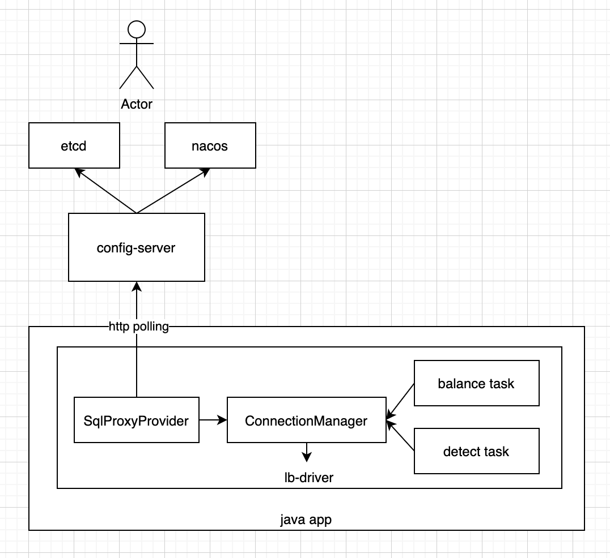

# lb-driver


Load-Balance-Driver, wrapper of mysql-jdbc-driver, suitable for use in databases with proxy architecture, such as OceanBase, TiDB, etc.


[](https://github.com/netease-im/lb-driver/releases)


简体中文 | [English](README_EN.md)

## 简介

* 参考了网易内部分库分表中间件DDB的LBDriver的代码，但是重写了代码，从而适配更一般的场景
* 适用于需要业务直连sql-proxy，而非通过负载均衡器（nlb/slb），使得负载均衡的逻辑从nlb/slb下沉到driver层
* 优点是使得sql-proxy的负载更均衡，且通过减少网络链路，降低rt，避免负载均衡器（nlb/slb）成为性能瓶颈
* driver会自动探活并屏蔽故障sql-proxy，自动均衡到各个sql-proxy的连接数
* 在对接config-server的模式下，可以不重启业务进程，做到快速上下线sql-proxy
* 仅依赖slf4j-api和mysql-connector-java，没有其他依赖
* 适用于oceanbase、tidb等

## 架构



## 使用方式

### 引入

```xml
<dependency>
    <groupId>com.netease.nim</groupId>
    <artifactId>lb-driver</artifactId>
    <version>1.0.1</version>
</dependency>
```
```
driver=com.netease.nim.lbd.LBDriver
```

### 本地模式

* 地址串配置的sql-proxy的节点列表，lb-driver直接从地址串中获取完整的sql-proxy节点列表，lb-driver会自动剔除不可用的sql-proxy节点

地址串示例：
```
jdbc:mysql:lb:local://10.189.0.1:6000,10.189.0.2:6000,10.189.0.3:6000/mydatabase?connectTimeout=5000&socketTimeout=10000&logStats=true
```

* `logStats` 表示是否打印统计日志，可选，默认false
* `checkBalanceIntervalSeconds` 负载均衡定时任务的间隔，可选，默认10s
* `checkHealthIntervalSeconds` 健康检查定时任务的间隔，可选，默认5s
* `unsupportedMethodBehavior` 调用不支持方法时的行为，`throwException` 或者 `ignoreCall`，可选，默认 `throwException`
* `exceptionSorter` 哪些异常需要重建连接到判断函数，配置全类名，需要实现 `ExceptionSorter` 接口，默认是 `com.netease.nim.lbd.MySqlExceptionSorter`


### config-server模式

* 地址串配置的是config-server的地址，lb-driver从config-server动态获取sql-proxy节点列表，从而可以不重启业务做sql-proxy的扩缩容
* config-server是无状态服务，可以部署多个节点，挂在nginx/nlb后端，达到集群高可用

地址串示例：
```
jdbc:mysql:lb:remote://config-server.xxx.com:8080/mydatabase?connectTimeout=5000&socketTimeout=10000&configServerApiKey=xxx&configServerSchema=im_user&logStats=true
```

* `config-server.xxx.com:8080` 表示config-server的地址，需要host:port的格式，如果省略端口，则默认80，如果是443端口，则走https，否则，走http，必填
* `configServerApiKey` 表示config-server的鉴权key，可选，取决于config-server是否开启了鉴权
* `configServerSchema` 表示config-server的schema，必填
* `configServerTimeout` 表示访问config-server的超时，单位毫秒，可选，默认5000
* `logStats` 表示是否打印统计日志，可选，默认false
* `checkBalanceIntervalSeconds` 负载均衡定时任务的间隔，可选，默认10s
* `checkHealthIntervalSeconds` 健康检查定时任务的间隔，可选，默认5s
* `unsupportedMethodBehavior` 调用不支持方法时的行为，`throwException` 或者 `ignoreCall`，可选，默认 `throwException`
* `exceptionSorter` 哪些异常需要重建连接，配置全类名，需要实现 `ExceptionSorter` 接口，默认是 `com.netease.nim.lbd.MySqlExceptionSorter`
* `az` 表示本机所属的可用区，可选。取值为运维约定的可用区名称，driver 不校验、不硬编码。也可用 `-Dlbd.az=xxx` 覆盖，优先级高于 url 参数（同一个 url 常被一批机器共用，用 `-D` 才能按机器覆盖）
* `ip` 表示本机 IP，可选，用于 config-server 反查可用区。driver 默认就会上报：显式配置 `ip` 时用配置值，否则取「连接 config-server 的 socket 本地地址」解析一次并缓存；解析失败则该次不发送该参数，由 config-server 用请求来源 IP 兜底，并按 `azRefreshIntervalSeconds` 退避重试（每次重试都要真连一次 config-server，不按刷新间隔重试会把刷新线程拖住）。`az` 缺省（靠服务端自动识别可用区）时同样会上报 `ip`
* `-Dlbd.ip=xxx` 优先级高于 url 上的 `ip`，可用于按机器覆盖；`az`/`ip` 的 `-D` 取值留空（如 `-Dlbd.az=`）等价于「不配置」，便于在共享 url 已配置时给个别机器清掉
* `azRefreshIntervalSeconds` 降级期间重新拉取本可用区 sql-proxy 集合的间隔，可选，默认30s
* `recoverCheckCount` 节点由不可达翻回可达所需的连续健康检查次数，可选，默认2

#### 多可用区（AZ）感知

* 正常用法是只依赖自动识别：URL 不配 `az`，driver 上报本机 IP，config-server 按网段反推可用区；`az` 只在自动识别不适用或不准时作为显式覆盖
* driver 在请求config-server时始终上报本机 `ip`，配置了 `az` 时额外透传 `az`，并恒定携带客户端能力等级 `clientFeatureLevel`（当前为 `2`）与 `clientVersion`（仅用于config-server侧日志观测）
* config-server 开启 `proxy.policy=az` 时，按客户端可用区下发本可用区的 sql-proxy 集合；未开启、未匹配到可用区，或客户端能力等级不足时，下发默认（全量）集合
* 本可用区集合全部不可达时，driver 会立即用 `policy=default` 异步请求一次默认集合（拉取在刷新线程执行，不阻塞触发降级的业务线程），并用默认集合承接新连接，同时告警日志中标记进入降级；本可用区节点连续 `recoverCheckCount` 次健康检查通过后，driver 自动切回本可用区（默认集合尚未取到时该次数上限压到 2 次，避免抖动反复提交兜底拉取）
* driver 只维护「当前需要用的集合」：正常态只有本可用区集合；降级期间为「默认集合 + 本可用区集合」，其中本可用区集合留在池中继续被探测（恢复判定依赖它），但不参与负载均衡。切回本可用区后默认集合从池中摘掉，下次故障再按需重新加入（重新探测与建链）
* 降级期间默认集合按5s刷新，本可用区集合按 `azRefreshIntervalSeconds` 刷新，两个变体各自维护独立的 `md5`
* 该能力只影响下发集合与选点范围，不改变连接数均衡、连接池与健康检查语义；未配置 `az` 时行为与之前完全一致
* 老版本 driver（不带能力等级）即使 config-server 开启了 AZ 亲和，仍会拿到默认集合，因此不会静默失去跨可用区兜底能力

> 可用区定义（`az.list`）、可用区到 sql-proxy 的映射（`az.proxy`）与下发模式（`proxy.policy`）在 config-server 侧配置，参考：[config_server](doc/config_server.md)；driver 侧只负责参数透传与降级兜底。

config-server的部署配置，参考：[config_server](doc/config_server.md)


## 测试用例

参考：[test_case](doc/test_case.md)


## 示例代码

参考：[example](lb-driver-example)

## 更新日志

参考：[更新日志](update.md)

## 博客文章

[网易开源 lb-driver：OceanBase OBProxy 驱动层负载均衡实践](https://open.oceanbase.com/blog/27234102304)

## 友情链接

[OceanBase](https://github.com/oceanbase/oceanbase)
[TiDB](https://github.com/pingcap/tidb)
